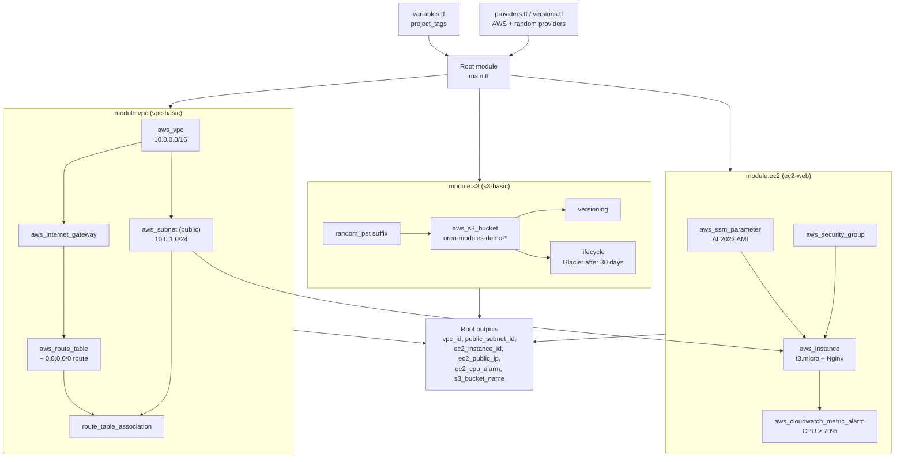

# Terraform Modules Project

Modular Terraform project for provisioning a small AWS environment using reusable infrastructure modules.

## What

This project provisions a small AWS environment from three independent, reusable modules:

- An S3 bucket with versioning and lifecycle configuration
- A minimal VPC with a public subnet
- An EC2 instance running an Nginx demonstration page, with a security group and an optional CloudWatch CPU alarm

The root configuration ([`main.tf`](main.tf)) connects these modules and exposes the resulting infrastructure IDs as outputs.



```text
terraform-modules-project/
├── modules/
│   ├── vpc-basic/
│   ├── ec2-web/
│   └── s3-basic/
├── docs/
│   ├── ARCHITECTURE.md
│   ├── USAGE.md
│   └── SECURITY.md
├── main.tf
├── providers.tf
├── variables.tf
├── outputs.tf
├── versions.tf
├── .terraform.lock.hcl
└── README.md
```

## Why

This project was built as a hands-on Terraform portfolio piece demonstrating:

- Reusable module design (network, compute, and storage kept independent)
- Root-module composition instead of a single monolithic configuration
- Input variables and outputs used for composition, not hard-coded values
- AWS provider configuration and pinned version constraints
- Safe Git practices around state and secrets (see [`docs/SECURITY.md`](docs/SECURITY.md))

## How

**Tech stack:** Terraform, AWS (VPC, EC2, S3, CloudWatch)

**Quick start:**

```bash
terraform fmt -recursive
terraform init
terraform validate
terraform plan -out=tfplan.bin
terraform apply tfplan.bin
```

**Cleanup:**

```bash
terraform destroy -auto-approve
```

See the `docs/` folder for details:

- [`docs/ARCHITECTURE.md`](docs/ARCHITECTURE.md) — what each module does and how they compose
- [`docs/USAGE.md`](docs/USAGE.md) — full command walkthrough, prerequisites, and output reference
- [`docs/SECURITY.md`](docs/SECURITY.md) — how state, secrets, and credentials are kept out of version control

Each module also has its own reference doc: [`modules/README.md`](modules/README.md), [`modules/vpc-basic/README.md`](modules/vpc-basic/README.md), [`modules/ec2-web/README.md`](modules/ec2-web/README.md), [`modules/s3-basic/README.md`](modules/s3-basic/README.md).
